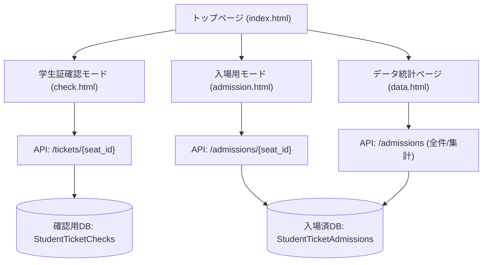
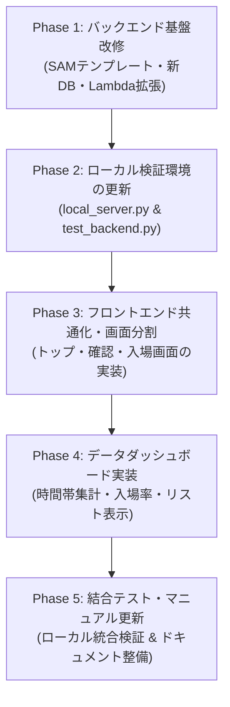

# サイト構成変更および入場管理・統計機能追加 変更計画書

本書は、学祭ライブにおける「学生証確認サービス」を拡張し、ポータル（トップページ）新設、実入場受付モードの新設（新DB連携）、および入場状況の集計・可視化を行うデータページの追加に向けた変更計画書です。

---

## 1. 改修の背景と目的

### 1.1 背景
従来システムは「学生証確認」専用の1画面完結型Webアプリとして設計されていましたが、当日の現場オペレーションでは以下の業務分離とリアルタイム把握が必要となっています。
1. **学生証確認窓口**: 事前に身元・チケット資格を確認するブース
2. **実入場ゲート**: 開場後にチケットをもぎり（または目視照会して）実際に入場を許可するゲート
3. **本部・統括**: 全体・ブロック別の入場進捗、時間帯別混雑推移をリアルタイムに把握する管理機能

### 1.2 改修目的
* **トップポータル新設**: 現場スタッフが役割に応じて「確認モード」「入場モード」「データ分析」を迷わず選択できるハブ画面を提供。
* **入場管理DBの新設**: 学生証確認とは独立した「入場履歴（席番、入場時刻、受付担当者）」を安全に記録・二重入場防止。
* **データ可視化ダッシュボード**: 入場率、時間帯別入場数、ブロック別入場者リストをリアルタイム表示し、混雑緩和や開演判断に寄与。

---

## 2. 新旧サイト・ディレクトリ構成

静的ホスティング（GitHub Pages）およびAWSサーバーレス構成との親和性を保ち、役割ごとに独立したURLと共通スタイル・共通設定を提供します。



### 2.1 ディレクトリ構成の変更

```text
.
├── index.html                   # 【新規】ポータル・トップページ
├── check.html                   # 【移動】学生証確認モード (旧 index.html)
├── admission.html               # 【新規】実際の入場用モード
├── data.html                    # 【新規】データ・統計ダッシュボード
├── config.js                    # 共通API設定
├── style.css                    # 共通スタイルシート (各画面対応のスタイルを追加)
├── app-common.js                # 【新規】共通ユーティリティ (担当者管理、トースト、通信等)
├── app-check.js                 # 学生証確認用ロジック (旧 app.js から分離)
├── app-admission.js             # 【新規】入場管理用ロジック
├── app-data.js                  # 【新規】データ集計・グラフ描画ロジック
├── MANUAL.md                    # 当日スタッフマニュアル (改訂)
├── README.md                    # システム概要・デプロイ手順 (改訂)
├── 変更計画書.md                # 本文書
└── backend/
    ├── template.yaml            # AWS SAM (新DynamoDB + 新エンドポイント追加)
    ├── lambda_function.py       # APIハンドラー (入場API & 集計API対応)
    ├── local_server.py          # ローカルE2E検証サーバー (新DB・新API対応)
    ├── seed_data.py             # 初期データ投入スクリプト (新旧テーブル両対応)
    └── test_backend.py          # 自動テストスイート (拡張)
```

---

## 3. 各画面の機能要件

### 3.1 トップページ (`index.html`)
* **目的**: 担当業務に応じたモードの選択ハブ。
* **画面要素**:
  * タイトル・イベント名・システム稼働状況（API疎通確認バッジ）。
  * 3つの機能カード（ワンタップで遷移可能）:
    1. **入場受付モード**: 「入場ゲート用。席番入力で入場処理・二重入場チェック」
    2. **学生証確認モード**: 「特設窓口用。学生証の目視照会・確認済み登録」
    3. **入場データダッシュボード**: 「統括・進行用。入場率・時間帯別推移・名簿」
  * 共通API接続設定ボタン（モーダル）。

### 3.2 学生証確認モード (`check.html`)
* **旧 `index.html` の完全移行**。
* 担当者名入力（揮発性メモリ保持）。
* テンキー入力による高速照会・登録・取消機能（既存ロジックを継承）。
* ヘッダーに「トップへ戻る」リンクを追加。

### 3.3 実際の入場用モード (`admission.html`)
* **目的**: 入場ゲートでのチケットもぎり・入場受付および二重入場抑止。
* **画面仕様**:
  * **担当者入力モーダル**: 初回アクセス時に入場ゲート担当者名を入力（メモリ保持）。
  * **入力インターフェース**: 確認モードと同一の「ブロック選択（A/B/C）＋オンスクリーンテンキー（0〜9）」を採用し、スタッフの誤操作を最小化。
  * **ステータス照会 & 入場処理**:
    * 3桁入力完了時に `GET /admissions/{seat_id}` を自動照会。
    * **未入場 (UNADMITTED)**:
      * 緑色基調の「入場を許可する」特大ボタンを表示。
      * タップ時に `PUT /admissions/{seat_id}` を送信し、入場時刻・担当者名を記録して即座に完了。
    * **入場済み (ALREADY ADMITTED)**:
      * **赤/橙色の警告アラート**（「⚠️ すでに入場済みです！」）。
      * 入場時刻（例: 17:42:15）と処理担当者名を表示。
      * 二重入場・不正入場を確実に抑止。
      * 誤操作時の「入場取消（未入場に戻す）」ボタンを用意。
    * **対象外 (NOT FOUND)**: 存在しない座席番号の警告。

### 3.4 データページ (`data.html`)
* **目的**: リアルタイムな入場進捗の可視化と来場者管理。
* **表示項目**:
  1. **入場率サマリー (KPIカード)**:
     * 全体入場数 / 総席数（例: 620 / 800席 - 77.5%）
     * ブロック別入場率（例: Aブロック 310/400 [77.5%], Bブロック 310/400 [77.5%]）
     * プログレスバー表示
  2. **時間帯別入場数グラフ / テーブル**:
     * 15分または30分刻みの入場人数推移（全体推移およびブロック別内訳）
     * ピーク時間帯や入場スピードの可視化
  3. **ブロック別入場者リスト (テーブル表示)**:
     * ブロック切り替えタブ（ALL / Aブロック / Bブロック）
     * カラム: `座席番号`, `入場時刻 (JST)`, `受付担当者`
     * 席番・担当者名のインクリメンタル検索フィルター、昇順/降順ソート
  4. **データ自動更新機能**:
     * 30秒または60秒ごとの自動再取得（手動「今すぐ更新」ボタン付き）
     * CSVエクスポート機能（イベント終了後の記録保管用）

---

## 4. データベース設計 (Amazon DynamoDB)

既存の確認テーブルとは物理的に分離し、データ整合性と独立性を担保します。

### 4.1 新規テーブル: `StudentTicketAdmissions` (入場記録)
| 属性名 (Attribute) | 型 | キー種別 | 説明 |
| :--- | :--- | :--- | :--- |
| `seat_id` | String | **Partition Key (PK)** | 座席番号 (例: `"A015"`) |
| `status` | String | - | `"ADMITTED"` または `"UNADMITTED"` |
| `admitted_at` | String | - | 入場時刻 (ISO 8601 UTC、例: `"2026-10-20T08:30:15Z"`) |
| `admitted_by` | String | - | 入場受付担当者名 (例: `"田中"`) |

> [!TIP]
> 席数は800席（A001〜A400, B001〜B400）規模であるため、データページでの全件走査（Scan）は DynamoDB の 1 回のリクエスト（1MB 未満）で完了し、極めて高速かつ安価に集計可能です。

### 4.2 既存テーブル: `StudentTicketChecks` (継続利用)
* 学生証確認専用テーブルとしてそのまま独立維持。

---

## 5. API 設計 (AWS Lambda & HTTP API Gateway)

### 5.1 入場管理エンドポイント
| メソッド | パス | 説明 | リクエスト例 / レスポンス例 |
| :--- | :--- | :--- | :--- |
| `GET` | `/admissions/{seat_id}` | 入場状態の照会 | レスポンス: `{"seat_id": "A001", "status": "UNADMITTED", "admitted_at": null, "admitted_by": null}` |
| `PUT` | `/admissions/{seat_id}` | 入場処理 / 取消 | リクエスト: `{"status": "ADMITTED", "operator_name": "田中"}` |

### 5.2 統計・一覧取得エンドポイント
| メソッド | パス | 説明 | 主なレスポンス内容 |
| :--- | :--- | :--- | :--- |
| `GET` | `/admissions` | 全入場者リスト及びサマリー | 800席分の状態、または入場済みレコード一覧（時刻・担当者含む） |

---

## 6. 実装ステップ・移行ロードマップ



### Phase 1: バックエンド基盤改修
1. `template.yaml`:
   * 新DynamoDBテーブル `StudentTicketAdmissions` を定義。
   * Lambda関数の権限に新テーブルのCRUD権限を追加。
   * ルーティングに `/admissions` および `/admissions/{seat_id}` を追加。
2. `lambda_function.py`:
   * `/tickets/...`（確認用）と `/admissions/...`（入場用）の分岐処理を実装。
   * 入場登録、二重入場防止チェック、全件取得エンドポイントの実装。
3. `seed_data.py`:
   * 入場用テーブルの初期化（UNADMITTED または事前レコード作成）に対応。

### Phase 2: ローカル検証環境の更新
1. `local_server.py`:
   * 新しい入場DBと集計エンドポイントのインメモリシミュレーションを追加。
2. `test_backend.py`:
   * 入場登録、重複警告、入場取消、データ集計の単体テストケースを追加・実行検証。

### Phase 3: フロントエンド共通化・画面分割
1. `index.html` をポータル画面として新設。
2. 既存の `index.html` を `check.html` に移行し、動作確認。
3. `admission.html` および入場用JSを作成。確認画面のテンキーUIを流用し、入場受付・二重入場警告UIを構築。

### Phase 4: データダッシュボード実装
1. `data.html` および `app-data.js` を作成。
2. 集計ロジックの実装:
   * **入場率**: ブロック別・全体のパーセンテージ計算とプログレスバー。
   * **時間帯別入場数**: 入場タイムスタンプを15分/30分/1時間枠にバケット分類して集計。
   * **ブロック別入場者リスト**: タブ切り替え、検索、ソート表示。
3. 自動リフレッシュ機能の実装。

### Phase 5: 統合検証 & ドキュメント改訂
1. ローカルサーバー（`python backend/local_server.py`）でのE2Eブラウザ検証。
2. `MANUAL.md` を「確認窓口編」「入場ゲート編」「本部統計編」に刷新。
3. `README.md` のデプロイ・運用手順を更新。

---

## 7. リスクと対策

| リスク要因 | 想定される影響 | 対策 |
| :--- | :--- | :--- |
| **端末の切り替えミス** | 前のスタッフのアカウント・名前で記録される | 画面リロードで担当者名を必ずリセット（揮発性保持仕様を踏襲）。 |
| **開場直後の集中アクセス** | 入場ゲートでの通信遅延 | DynamoDBはオンデマンドキャパシティで自動スケール。5秒タイムアウト＋ワンタップ再試行機構を維持。 |
| **二重入場事故** | 同一チケットで複数人が入場 | 入場済みステータス照会時に即座に赤色大画面警告を表示。 |
| **データページの頻繁アクセスによる負荷** | 集計APIへの過負荷 | クライアント側でポーリング間隔を30秒以上に制限。800件の一括Scan＋クライアント側集計によりDB負荷を最小化。 |

