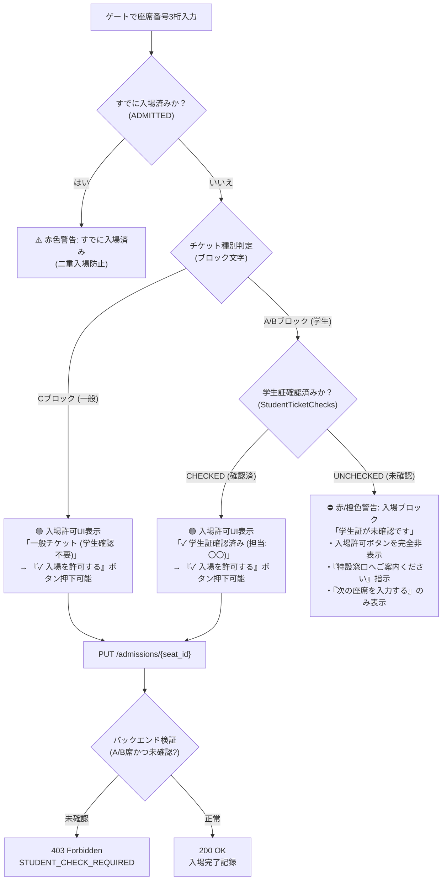

# 入場ゲートにおける学生証未確認チケット入場抑止機能 変更計画書

本書は、学祭ライブにおいて**「特設窓口で学生証確認を済ませていない学生チケット（Aブロック・Bブロック）」が開場後の入場ゲートから不正に入場することを確実に防止する**ための改修計画書です。

---

## 1. 改修の背景と目的

### 1.1 背景と課題
* **チケット種別とブロックの分離**:
  * **Aブロック（A001〜A100: 100席） / Bブロック（B001〜B310: 310席）**: 学生割引チケット（計410席）
  * **Cブロック（C001〜C390: 390席）**: 一般チケット（計390席、学生証確認は不要）
* **現在の課題**:
  * 実入場受付モード（`admission.html`）では、座席番号を入力した際に「入場DB（`StudentTicketAdmissions`）」のみを参照しているため、特設窓口での学生証確認（`StudentTicketChecks` で `CHECKED`）を済ませていない学生チケットであっても「入場を許可する」を押せてしまう。
  * これにより、学生証の提示をスキップした不正入場やオペレーションミスが発生する重大なリスクがある。

### 1.2 改修目的
1. **ゲートでの学生証確認ステータス連動**:
   * 入場ゲートで A/B ブロックの座席を入力した際、入場ステータスだけでなく**学生証確認ステータスを即座に連動照会**する。
2. **学生証未確認時の入場ブロック（UI & バックエンドの二重防御）**:
   * **UI側**: 学生証が未確認（`UNCHECKED`）の場合、**特大の警告バナー「⛔ 学生証が未確認です（入場不可）」**を表示し、「入場を許可する」ボタンをロック／非表示にして特設窓口へ案内する。
   * **バックエンド側**: `PUT /admissions/{seat_id}` で `ADMITTED` を受け付ける際、A/Bブロック座席であれば学生証確認DBを検証し、未確認なら **HTTP 403 `STUDENT_CHECK_REQUIRED`** で確実に拒絶する。
3. **一般チケット（Cブロック）の円滑な入場**:
   * Cブロックは学生証確認対象外であるため、余計なブロックを発生させず「一般チケット（確認不要）」としてスムーズに入場を許可する。

---

## 2. 状態遷移・入場判定フロー



---

## 3. システム設計・改修詳細

### 3.1 バックエンド改修 (`backend/lambda_function.py`)

#### (1) `GET /admissions/{seat_id}` のレスポンス拡張
座席の照会時に、チケット種別および学生証確認状態を自動付与して返却します。

* **レスポンス仕様 (A/Bブロック・確認済みの場合)**:
```json
{
  "seat_id": "A015",
  "status": "UNADMITTED",
  "admitted_at": null,
  "admitted_by": null,
  "ticket_type": "STUDENT",
  "student_check": {
    "status": "CHECKED",
    "updated_at": "2026-10-20T12:00:00Z",
    "updated_by": "佐藤"
  }
}
```

* **レスポンス仕様 (A/Bブロック・未確認の場合)**:
```json
{
  "seat_id": "A015",
  "status": "UNADMITTED",
  "admitted_at": null,
  "admitted_by": null,
  "ticket_type": "STUDENT",
  "student_check": {
    "status": "UNCHECKED",
    "updated_at": null,
    "updated_by": null
  }
}
```

* **レスポンス仕様 (Cブロック・一般チケットの場合)**:
```json
{
  "seat_id": "C050",
  "status": "UNADMITTED",
  "admitted_at": null,
  "admitted_by": null,
  "ticket_type": "GENERAL",
  "student_check": null
}
```

#### (2) `PUT /admissions/{seat_id}` の入場バリデーション強化
* `status: "ADMITTED"` のリクエストを受信した際、`seat_id` が A または B ブロックの場合：
  * `StudentTicketChecks` テーブルを照会。
  * `status != "CHECKED"` の場合は入場登録を拒絶し、以下のエラーを返却：
    * HTTPステータス: **`403 Forbidden`**
    * レスポンスボディ:
      ```json
      {
        "error": "STUDENT_CHECK_REQUIRED",
        "message": "学生証の目視確認が完了していないため、入場登録できません。特設窓口へご案内ください。",
        "seat_id": "A015"
      }
      ```
* `status: "UNADMITTED"`（入場取消）の場合は、誤操作救済のため制限なく許可。

---

### 3.2 フロントエンド改修 (`admission.html` / `app-admission.js` / `style.css`)

#### (1) `admission.html` の画面要素追加
* `#view-student-check-required` ビュー（または `#view-unadmitted` 内の動的分岐）：
  * **ステータスバッジ**: `学生証未確認 (入場不可)`（赤/橙色）
  * **警告バナー (`.alert-banner.alert-danger`)**:
    * タイトル: **「⛔ 学生証の確認が済んでいません！」**
    * 本文: **「この座席（A/Bブロック）は学生チケットです。特設窓口での学生証確認が完了していないため、入場を許可できません。来場者を特設窓口へご案内ください。」**
  * **アクションボタン**:
    * 「✓ 入場を許可する」ボタンを**完全に非表示（または無効化）**。
    * 「次の座席を入力する」ボタンを前面に配置。
    * （※もし当日通信トラブルや特認対応が必要な場合に備え、チーフスタッフ用の「窓口確認済みとして強制入場（特認）」オプションを小さく用意可能にする設計）。

#### (2) `app-admission.js` の制御ロジック
* `GET /admissions/{seat_id}` 取得後の分岐：
  1. `status === "ADMITTED"` → 既存の二重入場警告（`#view-admitted`）。
  2. `status === "UNADMITTED"`:
     * `ticket_type === "STUDENT"` かつ `student_check.status === "UNCHECKED"`:
       * **入場ブロックビュー**に切り替え、トースト警告「学生証が未確認のため入場できません」を表示。
     * `ticket_type === "STUDENT"` かつ `student_check.status === "CHECKED"`:
       * **学生確認完了バッジ**（確認担当・確認時刻）を表示し、「✓ 入場を許可する」ボタンを表示。
     * `ticket_type === "GENERAL"` (Cブロック):
       * **一般チケットバッジ**を表示し、そのまま「✓ 入場を許可する」ボタンを表示。
* ローカルモックモード（API未接続時）でも、A/Bブロックの一部で学生確認済み/未確認のシミュレーションができるようモックを連動。

---

### 3.3 変更対象ファイル一覧

| ファイルパス | 役割・変更内容 |
| :--- | :--- |
| **`学生証未確認防止_変更計画書.md`** | 本計画書 |
| **`backend/lambda_function.py`** | GET での確認DB連動照会、PUT での未確認チケット 403 拒絶ロジック実装 |
| **`backend/test_backend.py`** | A/B未確認チケットの入場拒絶テスト、確認済みチケット・Cブロックの入場成功テスト追加 |
| **`backend/local_server.py`** | ローカル結合サーバーでの確認DB連動シミュレーション追加 |
| **`admission.html`** | 学生証未確認警告UI、確認完了バッジ、一般チケットバッジのHTML要素追加 |
| **`app-admission.js`** | 学生証確認ステータスに応じた入場許可／ブロック制御ロジック実装 |
| **`style.css`** | 学生未確認警告バナー・バッジ用スタイルの追加 |
| **`MANUAL.md`** | スタッフマニュアルに入場ゲートでの「学生証未確認警告時の誘導手順」を追加 |
| **`仕様書.md`** | 要件定義・API仕様書に学生証確認連動・403エラー仕様を追記 |

---

## 4. テスト・検証項目

1. **未確認の学生チケット (A/Bブロック)**:
   * ゲート入力時、入場不可警告「⛔ 学生証の確認が済んでいません！」が表示され、入場許可ボタンが表示されないこと。
   * API に直接 `PUT` した場合でも `403 Forbidden` (`STUDENT_CHECK_REQUIRED`) が返ること。
2. **窓口で確認済みの学生チケット (A/Bブロック)**:
   * 窓口モード（`check.html`）で `CHECKED` に登録後、ゲート（`admission.html`）で入力すると「学生証確認済み」バッジが表示され、正常に入場許可できること。
3. **一般チケット (Cブロック)**:
   * 学生証確認を行っていなくても、ゲートで「一般チケット」としてそのまま正常に入場許可できること。
4. **二重入場の抑止**:
   * 入場済みの座席番号を入力した場合は、チケット種別に関わらず「すでに入場済みです！」が最優先で表示されること。

